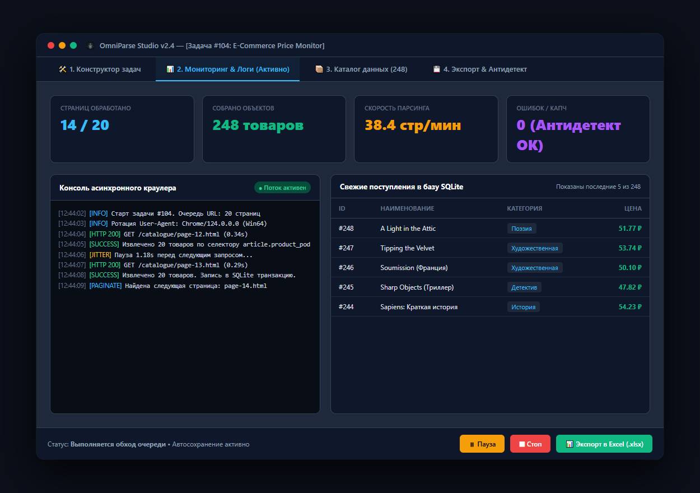

# OmniParse Studio

Модульный десктопный комплекс для визуального сбора, мониторинга и структурирования данных с веб-сайтов (e-commerce каталоги, доски объявлений, медиа-порталы).

Построен на многопоточной архитектуре с встроенной защитой от блокировок (антидетект), поддержкой динамической пагинации, хранилищем SQLite и пакетным экспортом в форматы XLSX, CSV, JSON и HTML.



## Архитектура проекта

Проект разделен на независимые функциональные слои:

```text
omniparse-studio/
├── omniparse/
│   ├── core/
│   │   ├── engine.py          # Многопоточный движок краулинга, контроль очереди и событий
│   │   ├── extractor.py       # Парсинг CSS-селекторов, извлечение атрибутов и цен
│   │   └── anti_detect.py     # Ротация User-Agent, джиттер задержек, заголовки реальных браузеров
│   ├── storage/
│   │   ├── database.py        # Слой данных SQLite: задачи, элементы, индексы
│   │   ├── models.py          # Модели ScrapeJob и ScrapedItem
│   │   └── exporters.py       # Генераторы Excel, CSV, JSON и автономных HTML-каталогов
│   └── ui/
│       └── app.py             # Многовкладочный интерфейс на CustomTkinter (4 вкладки)
├── tests/                     # Unit-тесты для парсинга и нормализации данных
├── run_studio.py              # Точка входа для запуска GUI
└── run_cli.py                 # Режим запуска из консоли для cron и headless серверов
```

## Функционал и вкладки

1. **🛠️ Конструктор задач (Task Builder):**
   - Настройка селекторов контейнера карточки, заголовка, цены, ссылки и кнопки следующей страницы.
   - Готовые встроенные пресеты для быстрого старта (книжные каталоги, блоги).
   - Ограничение глубины обхода, лимита страниц и настройка интервалов задержки.

2. **📊 Мониторинг & Логи (Live Monitor):**
   - Метрики в реальном времени: обработано страниц, найдено товаров, текущая скорость (страниц в минуту) и счетчик сетевых ошибок.
   - Кнопки управления жизненным циклом: «Пауза», «Возобновить», «Остановить».
   - Лог событий с цветной подсветкой статусов.

3. **📦 Каталог данных (Data Explorer):**
   - Таблица собранных записей с пагинацией и сортировкой.
   - Полнотекстовый живой поиск по названию и категории без задержки.

4. **💾 Экспорт & Антидетект (Export & Settings):**
   - Выгрузка в Excel (`.xlsx`), CSV (`.csv`) с кодировкой UTF-8 BOM, JSON (`.json`) и генерация автономной веб-витрины (`.html`).
   - Настройки антидетекта: рандомизация рефереров, ротация отпечатков User-Agent, поддержка прокси.

## Быстрый старт

### Требования
- Python 3.10+
- pip

### Установка и запуск GUI
```bash
git clone https://github.com/username/omniparse-studio.git
cd omniparse-studio
pip install -r requirements.txt
python run_studio.py
```

### Запуск в режиме консоли (CLI / Cron)
```bash
python run_cli.py --url "https://books.toscrape.com/catalogue/page-1.html" --limit 5 --export excel
```

### Запуск тестов
```bash
pytest tests/
```

